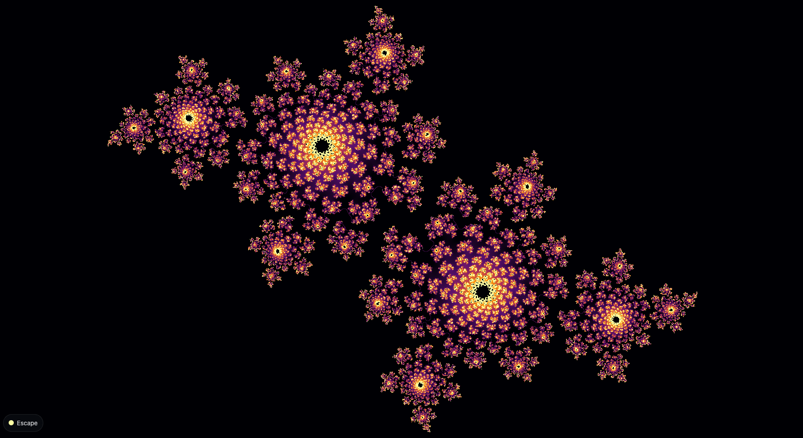

# Emergence lab

   

> Many agents following simple local rules exhibit *emergent
> behaviour*, seen in everything from ecosystems to economies.
>
> A test project for multi-agent orchestration across
> Claude and Codex using the Autometta repo. The higher tier models plan and orchestrate while lower tiers code and verify with clear boundaries. Cross-family orchestration improves outcomes and catches failure modes that a single model misses, at more than twice the cost...

[Run the app in a browser](https://anthonywest.co.uk/labs)

[View the research: Emergent behaviour from nature to management theory.](https://anthonywest.co.uk/research/emergent-behaviour-cross-domain)



## The twenty

Twenty simulations, each a deterministic kernel, behind one renderer. Each is a different
discipline's way of pointing at the same thing: local rules, global form.

- **Gray-Scott** reaction diffusion. Chemistry's version of the question.
- **Abelian sandpile.** Self-organised criticality in one toy.
- **2D Ising model.** A magnetic lattice assembling order at a phase transition.
- **Kuramoto oscillators.** Different rhythms crossing into collective synchrony.
- **Conway's Game of Life.** The original, and still the cleanest.
- **Belousov-Zhabotinsky** waves. The reaction that taught chemistry about excitable media.
- **Boids.** Flocking from three local rules.
- **Particle life.** A handful of attraction rules, and cells assemble themselves.
- **Physarum.** Slime-mould agents laying pheromone trails into networks.
- **Strange attractors** (Lorenz, Rössler, Thomas, Aizawa, Halvorsen: five variants, each its own card). Where deterministic equations stop being predictable.
- **Diffusion-limited aggregation.** How dendrites and lightning agree.
- **Elementary cellular automata.** Wolfram's one-dimensional zoo.
- **Brian's Brain.** Three states. Somehow it breathes.
- **Cyclic cellular automata.** Rock-paper-scissors that spirals into itself.
- **Lenia.** Continuous cellular automata, and life gets smooth gliders.
- **Mandelbrot, Julia, Burning Ship.** Iterated maps as the geometry of feedback.
- **Logistic Mandelbrot.** The bifurcation cascade hung off the Mandelbrot set as a curtain.
- **Clifford-DeJong.** Three variants, each its own card: Clifford, De Jong, and Svensson point-map attractors, with live coefficient drift.

Gray-Scott is the priority kernel. The sandpile and Boids are tuned as well.

## Defaults and presets

- **Opening view.** Every simulation opens with the parameters panel
  minimised and the hint "Adjust parameters: arrow tab on the left" until the
  tab (on the left edge of the view, opening the parameter sidebar) is first
  clicked.
- **Grid quality.** Performance, Balanced, High, Ultra and Extreme (Extreme
  only where a sim opts in). Each sim has its own default: Ultra for twelve,
  including Gray-Scott and Boids; Extreme for the sandpile and the
  logistic-Mandelbrot point cloud; High for Belousov-Zhabotinsky and Physarum;
  Performance for Lenia; Balanced for the other three. Tablets and phones are
  capped at Balanced, and phones open Gray-Scott, Belousov-Zhabotinsky,
  Physarum, logistic-Mandelbrot and Lenia at Performance.
- **Opening configurations.** Gray-Scott opens at three steps per frame,
  Cyclic CA on Square scrolls, the sandpile on Mandala with the pile fitted to
  the screen at one cell per device pixel, and Boids with five flocks close in,
  aimed just off the centre.
- **Built-in presets.** View > Kernel preset (in the sidebar's View section) lists 91 named parameter sets
  across the sims (Gray-Scott's Mitosis, Coral and Worms, the sandpile's
  Sandstorm and Mandala, Rule 30 and Rule 110 for the elementary automata, and
  so on).
- **Your presets.** The Presets section in the sidebar saves the current
  configuration (parameters, palette, display options, grid quality, speed) in
  the browser's local storage, up to 200. The gallery's Presets page opens,
  deletes, exports and imports them as a JSON file. It also lists ten
  read-only trial presets from the research sweeps under "From the research
  bench"; save a personal copy to change one.

## Run it

Needs Node 22.18 or later: `npm test` compiles the sources with `tsc` first,
and some tests (the sweep harness ones) import TypeScript directly, relying on
Node's built-in type stripping.

```bash
npm install
npm run dev
```

Open the URL Vite prints, normally `http://localhost:5173/`.

Checks:

```bash
npm run verify   # types, unit tests, production build
npm test         # unit tests only: 525, of which 83 are opt-in contract tests skipped by default
npm run build
```

The browser suites under `e2e/` run with Playwright (`npx playwright test`,
which starts its own Vite server on port 5173). Many of them are long sweeps
or GPU timing checks that expect a desktop browser with nothing else running.

Two URL parameters are useful when comparing paths:
`?simulationRenderer=cpu` keeps every GPU-capable simulation on its CPU
kernel, and `?orbit3dSampler=cpu` forces the logistic-Mandelbrot point cloud
onto its CPU sampler.

## Publish into the site

The lab's own standalone deploy serves from the root path (`/`) and is
unaffected by the steps below. To vendor a build into a host site instead, at
`/labs/app/`:

```bash
npm run publish:site
```

This publishes four artifacts (`scripts/publish-site.sh`), each rsynced with
`-a --delete` so stale files from a previous build are removed:

- `dist/` → `public/labs/app/`: the static app (Vite base `/labs/app/`),
  standalone and fullscreen target
- `dist-lib/` → `public/labs/lib/`: the library build (`vite.lib.config.ts`,
  entry `src/app/lib.ts`): the `<emergence-lab-sim>` web component plus
  `mountLab`, which the site's /labs/run shell imports by URL and mounts inline
- KaTeX css + fonts → `public/labs/app/katex/`: stable unhashed path the web
  component links into its shadow root (class rules) and the host document
  (font faces)
- registry manifest → `src/vendor/emergence-lab/registry.json`: lets the
  site's build fail on slug drift instead of shipping dead deep links

The promo-flow path defaults to a sibling checkout; override it with
`PROMO_FLOW_DIR` if promo-flow lives elsewhere:

```bash
PROMO_FLOW_DIR=/path/to/promo-flow npm run publish:site
```

Nothing is committed or pushed on the promo-flow side; that repository
commits its own copy of the vendored build.

## Baking a local point cloud

The logistic-Mandelbrot orbit3d view builds its point cloud in the browser,
time-sliced and capped so it stays responsive on whatever device it lands on.
That ceiling is the honest one for the web: the deployed app cannot assume a
desktop GPU, and a cloud dense enough to resolve the cascade tail runs to
hundreds of megabytes: the current machine-local bakes are 10 MB to 650 MB.
Nobody should be asked to download that over a network, so it never ships.

The active route is exposed on the simulation canvas as
`data-orbit3d-sampler` (the DOM form of `canvas.dataset.orbit3dSampler`):

| Path | When selected | `data-orbit3d-sampler` | `data-orbit3d-boundary-detail` |
| --- | --- | --- | --- |
| GPU sampled | WebGL2 float targets and the orbit sampler both complete | `gpu-sampled` | `active` when Boundary detail is raised; otherwise `off` |
| CPU sampled | GPU sampling is unavailable or fails; the time-sliced sweep completes | `cpu-sampled-gpu-failed` | `degraded` when requested; the normal Tail refinement plan is used |
| Prebaked ELPC | A valid requested local bake finishes loading and supersedes the live build | `prebaked` | `off`; Boundary detail applies only to live builds |
| 2D field | orbit3d setup or both live cloud builders fail | `orbit3d-fallback-field` | `degraded` when requested; otherwise `off` |

For a 3D cloud, `data-orbit3d-build="complete"` and a positive
`data-orbit3d-points` confirm that the selected path produced a whole cloud.
The 2D fallback intentionally has neither attribute.
Boundary detail is an opt-in GPU-only live-build control: at maximum it raises
the point budget from the unchanged 9.6M extreme ceiling to 20M (16M from the
lower grid tiers) and spends the additional capacity on a 5x5 boundary
sub-grid warmed for 20,000 iterations.
That depth is deliberate: stage 35 measured boundary-band period mismatch
falling from 1.71% at 1,500 warmup iterations to 0.25% at 20,000.
Tail refinement defaults to its maximum, 0.6, on both paths. On the GPU path
0 turns tail refinement off; the CPU fallback reads 0 as its automatic 0.3 share
and honours every positive setting up to 0.6. At 0.6 the CPU build takes
noticeably longer than at 0.3.

Instead the cloud can be baked offline, on the machine that will view it, with
no time-slicing, a much higher warmup, and a second refinement level the
browser can't afford:

```bash
npm run build:test                  # the baker reuses the compiled kernel
node scripts/bake-orbit3d.mjs --points 50e6 --warmup 30000 --out public/baked/lm-50M.elpc
```

Flags: `--points` (target total), `--samples` (orbit window per cell,
default 64), `--warmup` (default 20000), `--refine-fraction` (default 0.35),
`--out` (default `public/baked/logistic-mandelbrot.elpc`).

Total points ≈ cells × samples, so at a fixed `--points` budget raising
`--samples` buys vertical density in the attractor at the cost of resolution in
the *c* plane. Periodic cells only have *p* distinct heights however many
samples are taken; the chaotic bands are where extra samples show.

The live build and a bake lay their points out differently. Since card 103
the live build packs each cell's distinct points once: a period-*p* cell
occupies min(*p*, samples) rows of a slot, periodic cells share slots, and
Plotted iterations hides rows in the shader, so the base grid covers the whole
candidate pool at every Tail refinement setting and
`data-orbit3d-layout="packed"` is reported. A bake stays stacked (every cell
stores all of its samples, `data-orbit3d-layout="stacked"`), and the renderer
draws it exactly as before: the same point count, the same Plotted iterations
prefix and the same brightness, with the stacked energy factor applied in the
shader.

Each run writes the quantized `.elpc` binary and merges an entry into
`public/baked/index.json`. The app fetches that manifest at mount and turns it
into the **Model source** dropdown in the View controls: `live` plus one
option per bake. With no manifest the control is not rendered at all, and the
fetch is skipped outright unless the page is served from a local host, so the
published site never asks for a file that cannot exist there.

`public/baked/` is git-ignored and excluded from the publish rsync
(`scripts/publish-site.sh`), so bakes stay on the machine that made them.

## Stack

Vite and TypeScript throughout. Kernels are pure deterministic numerics
with no runtime dependencies. The renderer uses a quality-first WebGL2/GPU
path, including direct fragment-shader fractals, with Canvas 2D kept as a
fallback and debug surface.
Gray-Scott, Kuramoto and the sandpile step GPU-resident in WebGL2 wherever
float render targets are available, and Boids does the same on desktop. The
CPU kernels stay as the fallback and the reference: they run Boids on tablets
and phones, with obstacles or with large visual radii, and they take over if a
GPU engine fails. There is no WebGPU path.
Legacy browsers are not a target.

## Adding a simulation

1. Extend the `SimKernel` contract in [`docs/INTERFACE.md`](docs/INTERFACE.md) if the new sim needs it.
2. Add the kernel under `src/sims/<name>/` and wire the gallery in `src/app/**`.
3. Write the essay in `essays/<name>.md`.

There is no fixed split of the codebase by model: any agent may work any
part of it. Multi-agent work runs through autometta (a worker/verifier loop)
when parallel work and cross-checking are wanted. The kernel contract in
[`docs/INTERFACE.md`](docs/INTERFACE.md) stays a reviewed boundary. See
[`MODELS.md`](MODELS.md).

## Repository layout

```
emergence-lab/
  src/                    # kernels, renderer, controls, gallery
    sims/<name>/kernel.ts # deterministic kernel
    app/                  # renderer, gallery, controls, presets
  essays/                 # one .md per sim
  scripts/                # publish, deploy, thumbnail, sweep and point-cloud baking
  e2e/                    # Playwright browser suites and sweep harness
  public/baked/           # machine-local .elpc bakes + index.json (git-ignored)
  docs/
    INTERFACE.md          # the SimKernel contract
    PUBLISH-WORKFLOW.md   # publish-safety hooks and remotes
    stages/               # autometta stage cards, one per piece of work
    sweeps/               # interestingness sweep reports
    audits/ plans/ runs/ spikes/ ports/  # dated records
```

## Version history

| Version | Date | Summary |
|---|---|---|
| v0.2.0 | 2026-07-20 | Immersive fullscreen, web-component build + site publish pipeline |
| v0.1.0 | 2026-07-20 | Initial public mirror: 19 kernels behind one renderer |
