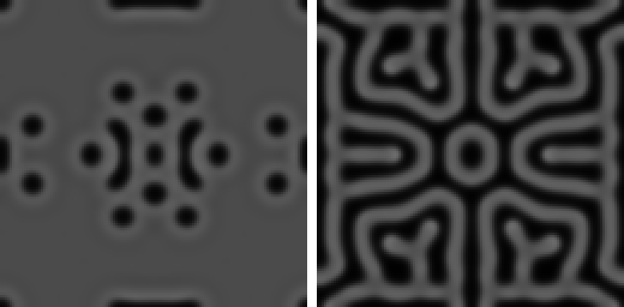
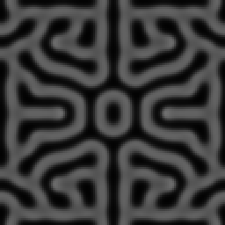
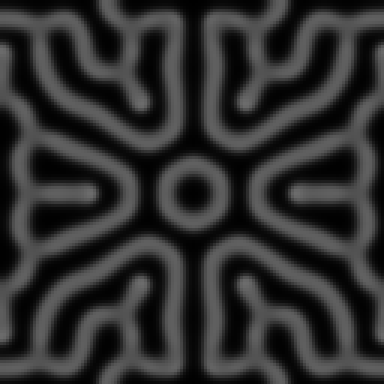
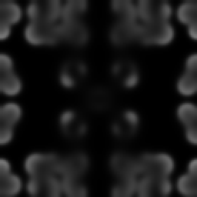
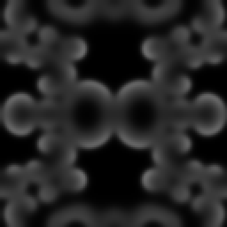
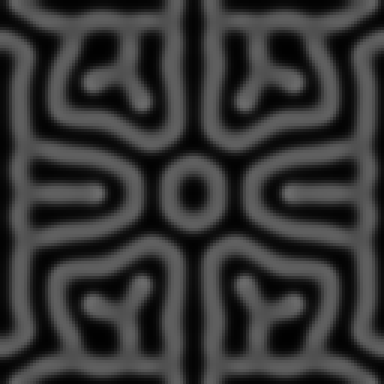
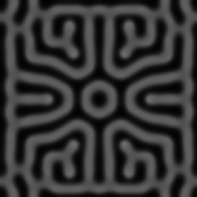

# Gray-Scott interestingness sweep — results & promoted presets

> **Evidence files.** Sweep evidence (ranked JSON, manifests, screenshots) is not kept in the repository; the harness writes it to git-ignored folders. File names below are plain text so they can be matched against a local run.

Generated by the Playwright interestingness-sweep harness (`e2e/`). Run it with:

```bash
SWEEP=1 npx playwright test sweep.spec.ts -g "gray-scott"
```

## Appendix: sub-unit timestep does not reach the glider regime — 2026-09-07

Stage 76 left one discretisation route open after the nine-point stencil also
failed to produce a U-skate glider: reduce the explicit-Euler timestep and run
more substeps for the same simulated time. This stage adds a selectable `dt`
parameter behind the unchanged default `dt=1`. The default five-point loop is
kept as its original arithmetic path, so omitting `dt` and setting `dt=1` are
bit-identical. A sub-unit value multiplies the Euler increment by `dt` and
runs `stepsPerFrame / dt` substeps per rendered frame.

### What was tried, and why

Three dyadic values were tried: `0.5`, `0.25`, and `0.125`. They are the
smallest useful powers-of-two bracket around the existing discretisation:
each doubles the number of cells represented per physical step while keeping
the simulated time per frame exact. The corresponding work is 2×, 4× and 8×
the default per frame. A smaller value would be another doubling with no new
mechanism to test, so it was not justified by this negative result.

The canonical pair was run at the harness resolution, 128×128, with the
shipped `Du=0.2097`, `Dv=0.105`, `stepsPerFrame=20`, and 700 `step()` calls.
The whole stage-73 box was run at every one of the 210 slider pairs
(`F=0.056..0.066`, `k=0.0590..0.0635`, both in 0.0005 increments). The
`dt=0.5` pass used 96×96, matching the prior box probe's resolution. The
`dt=0.25` and `dt=0.125` passes used a 32×32 coarse screen to keep the
proportionally larger substep cost bounded; the canonical pair remained at
128×128 for all three values. Each run checked the V>0.2 components after
step 700 and again after step 800, matching components by size and wrapped
centroid and counting a displacement of at least three cells as translation.

| dt | box grid | box sets | alive at 700 | translated 700→800 | canonical coverage at 700 | canonical coverage at 800 |
|---:|---:|---:|---:|---:|---:|---:|
| 0.5 | 96² | 210 | 67 | 0 | 0.9485 | 0.9534 |
| 0.25 | 32² coarse screen | 210 | 81 | 0 | 0.9485 | 0.9536 |
| 0.125 | 32² coarse screen | 210 | 81 | 0 | 0.9482 | 0.9536 |

At the canonical pair, all three values produced one connected V>0.2 filled
component with no centroid translation. The field remains the same washout
described by the earlier appendix: sub-unit integration changes the last few
digits and the timing of the front, not the positive-velocity invasion that
closes across the torus. The coarse whole-box screens likewise found no
translated structure at any tested pair. Their resolution is explicitly a
screen, not a claim that 32² can resolve a glider; the full-resolution
canonical check is the decisive result for the named pair.

### Default reproduction

The six shipped presets were re-scored with the default five-point stencil and
`dt=1`, through the same 128×128, 700-call path used by the existing sweep.
Every score reproduces the recorded five-point column to the digit:

| preset | F | k | default score |
|---|---:|---:|---:|
| Waves | 0.018 | 0.0487 | 0.7963458726372294 |
| Spots | 0.026 | 0.0597 | 0.7411929696553551 |
| Coral (Default) | 0.0545 | 0.062 | 0.7102674508287455 |
| Worms | 0.054 | 0.063 | 0.7087181881369251 |
| Maze | 0.029 | 0.057 | 0.6896900329572433 |
| Mitosis | 0.0367 | 0.0649 | 0.6528595882826324 |

### Result

No. Neither `dt=0.5`, `dt=0.25`, nor `dt=0.125` produces a recognisable
travelling glider at the canonical U-skate pair, and no pair in the searched
stage-73 box produced a translating component. The remaining route would be a
still smaller timestep or a materially different spatial discretisation/
kernel, but the tested powers-of-two already add up to 8× compute and do not
change the regime. There is no justified timestep left to try in this kernel;
the U-skate question is closed as a negative result. No preset, metric, weight,
or default was changed.

Artifacts (per-candidate grayscale field PNGs, full ranked JSON, a generated
report) land under `e2e/artifacts/gray-scott/` (git-ignored).

## How the harness scores a frame

The sweep drives the **real kernel** headlessly through the Vite dev server: it
imports `src/app/registry.ts` in the page, constructs a fresh `GrayScottKernel`,
injects an F/k parameter set, steps it deterministically (128×128 grid, 700
`step()` calls ≈ 14 000 Euler iterations so the regime fully develops), and reads
the `V` channel back as a float field. It scores that field — not the rendered
pixels — because the field is the deterministic ground truth the renderer merely
colours: same params + same step count ⇒ identical field ⇒ identical score, with
no dependence on colour map, GPU, or frame timing.

Four metrics, combined into one composite (see `e2e/harness/metrics.ts`):

- **entropy** — Shannon entropy of the intensity histogram (rich vs flat).
- **spatial autocorrelation** — Moran's-I-style coherence (structure vs noise).
- **temporal flux** — mean per-cell change between two frames (alive vs frozen).
- **coverage** — fraction of the field above background (fills space vs empty).

`score = coverageFactor · (0.55·structure + 0.45·detail) · liveliness`, where
`coverageFactor` plateaus for coverage in ≈[0.12, 0.85] and falls to 0 for an
empty or saturated field, and `liveliness` is a gentle flux bonus (floor 0.85).

## Result: re-baselined against the current warm-start kernel — 2026-08-31

The kernel has changed twice since the numbers above were first captured
(2026-06-06): a fast approximate single-wave warm start landed 2026-07-16,
then was itself replaced the next day by the current seed — concentric rings
of small V blobs in undepleted U (`seedOrigins()` in
`src/sims/gray-scott/kernel.ts`), which is what every regime has actually run
on since 2026-07-17. Every absolute score below is fresh: same harness
settings as always (128×128 grid, 700 `step()` calls ≈ 14 000 Euler
iterations, channel 1/V, coverage threshold 0.1), same composite, same
weights — this run only changes the seed under test.

### Coverage of the search

- **Sets evaluated: 56** — F ∈ linspace(0.01, 0.066, 8) × k ∈
  linspace(0.045, 0.067, 7).
- **References evaluated: 7** — all shipped presets, unmodified (Mitosis,
  Coral, Worms, Maze, Spots, Waves, U-skate gliders).
- **Sets skipped: 7325.** The unbudgeted grid is the full `paramSchema`
  slider space, F at 121 steps (0.01–0.07 by 0.0005) × k at 61 steps
  (0.04–0.07 by 0.0005) — 7381 sets over the same ranges.
- **Not searched at all: 3 params** — `Du`, `Dv`, `stepsPerFrame`. Diffusion
  rates and the integration rate stay pinned at the shipped defaults
  (0.2097, 0.105, 20 steps/frame); the sweep ranks presets purely on F/k
  placement, as it always has.

### Every shipped preset: old score vs new score

| Preset | F | k | old score | new score | Δ |
|---|---|---|---:|---:|---:|
| Waves | 0.018 | 0.0487 | 0.831 | **0.796** | −4.2% |
| Spots | 0.026 | 0.0597 | 0.743 | **0.741** | −0.2% |
| Coral (Default) | 0.0545 | 0.062 | 0.722 | **0.710** | −1.6% |
| Maze | 0.029 | 0.057 | 0.695 | **0.690** | −0.8% |
| Mitosis | 0.0367 | 0.0649 | 0.661 | **0.653** | −1.2% |
| Worms | 0.054 | 0.063 | 0.704 | **0.709** | +0.7% |
| U-skate gliders | 0.062 | 0.0609 | 0.143 | **0.201** | +40.0% |

"Old score" is the 2026-06-06 sweep's number for that preset's exact F/k pair
(the Spots and Waves rows use the *promoted* parameters, since those are what
ships today; the params that scored 0.000/0.669 pre-promotion no longer exist
anywhere in the repo). Worms and U-skate gliders were never added to the
sweep's reference set at any point before this stage, so neither preset has a
number on record from an actual 2026-06-06 run — see `e2e/harness/sims.ts`,
which now carries all seven shipped presets as references so this gap cannot
recur. Their old scores above were produced retroactively for this stage by
running the pre-warm-start kernel (`git show 37f585f:src/sims/gray-scott/kernel.ts`,
the last commit before the fast approximate warm start landed) under the
*current* harness and composite, at the same F/k pairs and the same 128×128/
700-step settings as every other row. That mixes an old kernel with a newer
harness, which is only valid because the composite formula and weights have
not changed since 2026-06-06 (confirmed above against `metrics.ts`) — the
harness additions from cards 63/65/66/67 are all new metrics or new sim
support, not changes to how Gray-Scott's four scores combine.

### Null result: the ranking is unchanged

Every one of the five previously-tracked presets moved down by 0.2–4.2% on
the composite, and with old numbers now available for all seven shipped
presets, the **full seven-way ranking is identical before and after the seed
change**: Waves > Spots > Coral > Worms > Maze > Mitosis > U-skate gliders,
both old and new. Worms sits between Coral and Maze in both runs (0.704 old,
0.709 new); U-skate gliders sits last by a wide margin in both (0.143 old,
0.201 new). This is the useful null result the card anticipated — the other
eleven sweep write-ups that cross-reference this file's metric definitions
and Gray-Scott's numbers are still sound; nothing about the composite or the
ranking it produces moved when the seed did. The five previously-tracked
presets' small uniform downward drift (none moved by more than 4.2%) is
consistent with the new seed's many-smaller-blobs-in-rings layout reaching
the same steady-state regimes slightly less completely by step 700 than the
old single-wave-derived seed did, not with any regime changing character.
U-skate gliders is the outlier in degree, not direction: it moved *up* 40.0%,
the subject of its own section below.

### Pre-existing defect: U-skate gliders is broken under both seeds (score 0.201, was 0.143)

U-skate gliders (`F=0.062, k=0.0609`) is far below every other preset in both
runs — old and new, its next-lowest neighbour (Mitosis) scores 3.2×–4.6×
higher. Its frame (`e2e/artifacts/gray-scott/u-skate.png`, git-ignored,
regenerate with the command above) is a near-uniform mid-grey field with only
a handful of small dark dots scattered across it — coverage 0.9485, above the
composite's ≈0.85 saturation edge, entropy 0.3753 (well below the other
survivors' 0.47–0.70), and temporal flux 0.001534 (frozen by step 700). This
is the same class of defect the 2026-06-06 run found in the old Waves preset:
a dead-or-saturated field, not a tuning question — except here it is not new.
The retroactive old-kernel measurement above (0.143) shows U-skate gliders
was *already* in this state under the pre-warm-start square seed; the current
warm-start seed does not explain the defect and in fact scores it 40% higher
without fixing it. The F/k point sits in a narrow sliver of surviving
parameter space under the current seed — every swept set at F=0.066 (one grid
step higher) is fully dead or saturated (score 0.000), and F=0.062 was never
itself a swept grid point, so the sweep did not characterise the regime
around it. Per the card's escalation rule this is recorded, not fixed:
U-skate gliders needs its own follow-up sweep (a finer F/k pass bracketing
0.058–0.066, or a from-scratch look at whether either seed can produce the
travelling-glider regime at all) before any retuning or promotion decision.

No promotion was made. The top of the swept grid is occupied by the shipped
Waves and Spots parameter points themselves (0.796 and 0.741, both exact
grid points reproduced by the sweep) — nothing beats them. The next-nearest
swept neighbours to Coral, Maze, Mitosis and Worms score within 2.3% of the
shipped preset in the same F neighbourhood, under the 5% promotion bar; the
one candidate that clears 5% against Mitosis (`F=0.034, k=0.0597`, +8.0%) is
visually a maze/worm regime, not a mitosis-family splitting-dot pattern, so
it is not a same-character replacement and was not promoted.

## Notes / honest limitations of the metric

- The composite is a **ranking aid, not an oracle** — the final aesthetic call is
  a human/Opus judgement made by eyeballing the field PNGs the harness emits. It
  mildly over-rewards *sparse but coherent* frames (e.g. a single labyrinth
  "flower" on black scores ~0.71 on high autocorrelation despite being mostly
  empty). Coverage-gating limits this but does not eliminate it.
- **Seed symmetry.** Every Gray-Scott regime is radially symmetric because the
  kernel seeds one central blob plus concentric rings of blobs at fixed radial
  spacing in a periodic domain (`seedOrigins()`). The sweep frames remain
  mandala-like; this is faithful to the live sim's behaviour, just smaller and
  earlier.

## Lorenz & Boids (swept, not promoted)

- **Lorenz** (`-g lorenz`): higher rho (~37–42) with a long fade (0.997) draws the
  full layered butterfly (score ≈0.60–0.63), whereas the classic `rho=28`
  app-default reads as a thin one-wing trace (0.174) — the trajectory lingers on
  one wing and the short trail decays before both light up. No promotion was made:
  `rho=28` is the canonical Lorenz value and the existing **Wide wings** preset
  (`rho=35`) already renders the full butterfly. A single snapshot of a
  trajectory sim is also timing-sensitive; a multi-snapshot average would score
  Lorenz more robustly. Filed as future work.

  > **Closed — stage `67-lorenz-multi-snapshot-scoring`, completed
  > 2026-08-30T22:14:53Z, commit `2a5b388` (reconciled 2026-09-02, stage
  > `74-sweep-write-ups-record-what-landed`).** See "Appendix: Lorenz
  > multi-snapshot scoring — 2026-08-30" below.
- **Boids** (`-g boids`): the occupancy-field lens is the wrong instrument for a
  sparse swarm — all sets score ≈0.02 because binary point-density on a 200²
  grid carries almost no spatial-autocorrelation signal. Flocking "interest"
  lives in **velocity coherence** (the kernel's vx/vy channels 2–3), not occupancy
  texture. A polarisation/order-parameter metric on the velocity channels is the
  right follow-up before tuning Boids by measurement.

  > **Closed — stage `63-point-cloud-metrics`, completed
  > 2026-09-01T18:59:14Z, commit `2bf4c47` (reconciled 2026-09-02, stage
  > `74-sweep-write-ups-record-what-landed`).** Both the smoothed-density
  > point-cloud instrument and per-set velocity coherence were built and
  > wired to Boids. See `docs/sweeps/boids-interestingness.md` (new file,
  > this stage).

## Appendix: Lorenz multi-snapshot scoring — 2026-08-30

The Lorenz sweep now opts into **N=5** deterministic frame pairs, with frame A
captured after **280, 420, 560, 700, and 840** kernel steps and frame B eight
steps later. Every position starts from a fresh kernel. The harness reports the
mean plus min, max, and population standard deviation for every metric; sims
without this opt-in retain the original single-pair result shape and execution
path.

| set | single score at step 280 | N=5 mean | min–max | std dev |
|---|---:|---:|---:|---:|
| rho=28, sigma=10, fade=0.992, steps/frame=6 | 0.610012 | 0.595079 | 0.577254–0.610012 | 0.010529 |
| rho=35, sigma=10, fade=0.990, steps/frame=12 | 0.677307 | 0.678021 | 0.672011–0.686087 | 0.005620 |
| rho=37, sigma=10, fade=0.997, steps/frame=6 | 0.685512 | 0.684172 | 0.679966–0.690644 | 0.003716 |
| rho=42, sigma=10, fade=0.997, steps/frame=6 | 0.687707 | 0.700738 | 0.687707–0.708288 | 0.006968 |

The score spread is small: 0.004–0.011 standard deviation, and averaging moves
the four single-frame readings by −0.015, +0.001, −0.001, and +0.013. The live
headless harness no longer reproduces the historical rho=28 score of 0.174
recorded above; at the same configured step 280 it now produces 0.610012. On
the current kernel, timing noise therefore does not explain a large ranking
gap. Multi-snapshot scoring is still the more robust trajectory measurement,
but it does not change the preset conclusion: canonical rho=28 stays, and the
existing **Wide wings** rho=35 preset already covers the fuller butterfly. No
preset was changed.

On this machine the four-set headless measurement completed in 3.96 seconds
including browser and dev-server startup. Individual single-pair drives took
75–115 ms; their five-snapshot counterparts took 405–446 ms, about 3.7–5.7×
the wall-clock cost.

Clifford–De Jong remains on single-pair scoring: its coefficients are pinned,
its 260-step warmup is already about 2.6 trail-decay convergence times, and the
documented sensitivity is saturation/framing rather than trajectory timing.
DLA also remains single-pair: its seed is pinned and its 500-step scoring point
is a terminal cluster state with exactly zero flux, so later snapshots would be
identical rather than a timing sample.

## Appendix: multi-lag structure term cross-check — 2026-08-30

Stage 66 added `multiLagSpatialAutocorrelation` (`e2e/harness/metrics.ts`), a
generalisation of the existing lag-1 spatial autocorrelation across lags
{1, 2, 3, 4, 6, 8} that reports the strongest reading found at any of them. Full
write-up and the Game of Life rescue case are in
`docs/sweeps/game-of-life-interestingness.md`.

Re-running Default (Coral) reproduced the composite's recorded contract-test
values exactly: entropy 0.6967874006572629, spatial autocorrelation
0.9369885340278952, coverage 0.6756591796875, temporal flux
0.0011477361467768787, score 0.7102674508287455 — confirming acceptance
criterion 3, the composite path is untouched by this card.

| reference | lag-1 (existing) | multi-lag (new) | disagreement |
|---|---:|---:|---|
| Default (Coral) | 0.9370 | 0.9370 | none |
| Mitosis | 0.9489 | 0.9489 | none |
| Maze | 0.9392 | 0.9392 | none |

None. Gray-Scott's Turing patterns are smoothly-varying reaction-diffusion
textures with a wavelength well above 1-2 cells, so the lag-1 term already
reads them near-maximally and the wider lag set finds nothing stronger — same
result as the Ising cross-check above. Across all three sims checked for this
card (Game of Life, Ising, Gray-Scott), the new term only disagrees with the
old one on the one case it was built for: Game of Life's "Maze-like" preset.

## Appendix: U-skate gliders retired — 2026-09-02

The shipped **U-skate gliders** preset (`F=0.062, k=0.0609`) rendered a
near-uniform mid-grey field with a handful of small dark dots. It has been
removed from `src/app/presets.ts`; Gray-Scott now ships six presets. This
appendix records the measurement that retired it, because the parameter pair is
the canonical one from the literature and will look correct to the next reader
who checks it against a reference.



*Left: the retired preset. Right: Coral, for scale. Both are the sweep's own
artefact — the V field at 128×128 after 700 `step()` calls, grayscale, 3×
nearest-neighbour upscale. Left is not a low-scoring pattern; it is the absence
of one.*

### Before and after

| preset | F | k | score | entropy | autocorr | coverage | flux |
|---|---:|---:|---:|---:|---:|---:|---:|
| U-skate gliders (retired) | 0.062 | 0.0609 | **0.200813** | 0.3753 | 0.9303 | 0.9485 | 0.001534 |
| Coral (Default) | 0.0545 | 0.062 | 0.710267 | 0.6968 | 0.9370 | 0.6757 | 0.001148 |
| Worms | 0.054 | 0.063 | 0.708718 | 0.6910 | 0.9411 | 0.6080 | 0.000900 |
| Maze | 0.029 | 0.057 | 0.689690 | 0.6488 | 0.9392 | 0.6573 | 0.000502 |
| Mitosis | 0.0367 | 0.0649 | 0.652860 | 0.5350 | 0.9489 | 0.3113 | 0.001005 |
| Spots | 0.026 | 0.0597 | 0.741193 | 0.5260 | 0.9491 | 0.2766 | 0.031086 |
| Waves | 0.018 | 0.0487 | 0.796346 | 0.5806 | 0.9729 | 0.4063 | 0.148948 |

There is no "after" score, because there is no repaired preset: the search below
found nothing to repair it to. The other six presets are untouched and reproduce
the values above exactly (Coral to all sixteen digits of the figure the
contract test in `e2e/sweep.spec.ts` pins, `0.7102674508287455`).

Coverage 0.9485 is past the composite's ≈0.85 saturation edge and entropy 0.3753
is well below the 0.47–0.70 the survivors manage, so the composite is reading the
frame correctly. The instrument is not what was wrong.

### Which cause: the pair, not the seeding or the step budget

The two candidate explanations were a wrong or drifted F/k pair, and a right pair
that the seed geometry or step budget never lets develop. It is the pair, and the
pair has not drifted — `F=0.062, k=0.0609` is the canonical u-skate point from the
Gray-Scott literature, in the same non-dimensional units this kernel uses
(`Du/dx²·dt = 0.2097`). It was copied correctly and does not survive this
kernel's discretisation.

What the field actually does at that pair: it runs to a homogeneous steady state
and stops. The medium is bistable here, between an *empty* state (`U=1, V=0`, the
undepleted background every seed is dropped into) and a *filled* one. Solving the
reaction terms for `F=0.062, k=0.0609` puts the filled state at `U≈0.4199,
V≈0.2927`, and the whole field converges to exactly that — measured `V` median
0.293 by step 200, the dark dots being the few pinned holes left over from the
seed rings.

- **Not the step budget.** Coverage and flux are flat from step 2000 onwards:
  coverage 0.9623 at flux 1×10⁻⁵ at step 2000, then coverage 0.9620 at flux
  0.00000 from step 5000 all the way to step 40 000 (800 000 Euler iterations,
  57× the sweep's budget). Nothing further happens, ever.
- **Not the seeding.** Wiping to the empty state and painting a single 8×8 patch
  of V reproduces the same end state: the filled region invades outward without
  bound (coverage 0.0039 → 0.19 → 0.59 → 0.948 at steps 0/100/200/400) and
  freezes when it meets itself around the torus. A smaller 9×4 patch is below the
  critical nucleus and dies outright. Nothing between those two yields a bounded
  structure, because at this pair the empty→filled front has a positive velocity,
  which is exactly the condition under which an isolated soliton cannot exist. No
  seed geometry can outrun an invading front.
- **Not the sweep's grid either.** Same behaviour at every resolution, including
  the ones the live app runs at: coverage 0.813 / 0.948 / 0.959 / 0.907 / 0.915 at
  96², 128², 192², 256², 384², with flux ≤ 0.0016 at step 700 and ≤ 0.0004 at step
  2000 in every case, and the composite never above 0.69. The bigger grids take
  longer only because the front has further to travel before it closes; the end
  state is the same everywhere.

What a visitor actually saw is worth stating precisely, because it is not blank
from the first frame. Driving the live page (Playwright, WebGL2, the default
balanced grid) at `F=0.062, k=0.0609` shows an expanding disc with a busy,
decorated rim for the first few minutes — the invasion front crossing the grid,
and genuinely nice to look at. Then the front closes on itself, the interior is
the uniform filled state, and the sim stops changing for as long as it is left
running. That transient is a property of the saturating band, not of this pair in
particular, and it contains no travelling structures: the rim advances, nothing
crosses the field.

### What was searched

Two passes, both headless, both on the harness's own settings (V channel,
700 `step()` calls, coverage threshold 0.1, composite unchanged), with a
structure-tracking pass added on top: label the connected components of
`V > 0.2`, match them between frames 100 steps apart, and report how many
translated. Calibration on the shipped presets behaves as it should — Mitosis,
Coral, Maze and Worms register no translation, Waves and Spots do.

1. **The whole slider plane, 651 sets.** `F` ∈ [0.010, 0.070] step 0.002 × `k` ∈
   [0.040, 0.070] step 0.0015, at 96². Everything at `F ≥ 0.056` is dead,
   saturated, or a static labyrinth. The sets with translating structures are all
   at low feed, `F` ≈ 0.012–0.028 with `k` ≈ 0.049–0.060, plus a few weak cases
   beside Mitosis at `F` ≈ 0.036–0.038, `k = 0.0655`.
2. **The u-skate neighbourhood at full slider resolution, 210 sets.** `F` ∈
   [0.056, 0.066] × `k` ∈ [0.0590, 0.0635], both at step 0.0005 — that is *every
   pair the F and k sliders can express* in the box around the shipped point,
   scored at 128². 69 are alive at all; **none has a single translating
   structure.** The best of them is a frozen labyrinth: `F=0.0585, k=0.0635`
   scores 0.728 at flux 0.0052, and `F=0.062, k=0.0615` — 0.0006 above the
   shipped kill rate, the same feed — scores 0.727 at flux 0.0032. Those are the
   Coral/Worms regime under another name, not gliders.

The low-feed region from pass 1 was then checked for whether its motion persists
or is just the seed rings expanding. It persists: at `F=0.024, k=0.058` the
composite runs 0.751 at step 700 and 0.781 at step 5000, with 56 of 60 and 68 of
76 components displaced by 6–10 cells per 100 steps respectively. But following
individual structures over 480 steps shows they do not *travel*: mean path length
54–240 cells against mean net displacement 10–20 cells (straightness 0.04–0.26).
They split, merge and pulse in place. That regime is the travelling-wave and
self-replicating-spot family the shipped **Waves** (0.796) and **Spots** (0.741)
presets already occupy, so it offers no distinct preset even setting the name
aside.

### Result: a negative one, per the card's escalation

No pair reachable on this sim's sliders produces recognisable travelling gliders
at the resolution and step budget it ships with. The likely reason is
discretisation rather than parameters: u-skate solitons need more grid cells per
feature than this kernel can give them. Feature size in cells scales as √Du, and
`Du = 0.2097` is already 84% of the explicit-Euler stability ceiling (0.25 for
the five-point Laplacian at `dt = 1`), so it cannot be raised. Getting the
solitons would take a nine-point stencil or a smaller timestep — a kernel change
that moves every Gray-Scott preset, not a preset change.

Given that, the preset was retired rather than renamed. Renaming would have meant
shipping `F=0.062, k=0.0609` under an honest label, and the honest label for that
frame is "saturated washout", which is not worth a slot in the dropdown. Nothing
else changed: no other preset, no metric, no weight, no sweep setting.

Two things a future card could pick up, neither of them decided here:

- **The `F=0.062, k=0.0615` labyrinth (0.727).** A real pattern a hair above the
  retired kill rate, but static, and close enough to Coral (0.710) and Worms
  (0.709) that it would need a visual case for why the set needs a third of them.

  > **Closed — rejected, stage `75-gray-scott-labyrinth-preset`, 2026-09-03.**
  > Not promoted. The visual case does not hold and the pair is one `k` slider
  > tick from a dead field in both directions. See "Appendix: the 0.727
  > labyrinth rejected — 2026-09-03" below.
- **Gliders at a finer discretisation.** A nine-point Laplacian or a sub-unit
  timestep is the only route to the regime the retired preset was named for, and
  it is a kernel-wide decision with its own re-baseline attached.

  > **Closed — negative, stage `76-gray-scott-nine-point-laplacian`,
  > 2026-09-03.** A selectable nine-point Laplacian landed in the kernel behind
  > the five-point default. At the shipped grid and step budget it produces no
  > travelling structure at `F=0.062, k=0.0609` or at any of the 210 pairs in
  > this appendix's u-skate box; the default stencil and the six presets are
  > unchanged. See "Appendix: the nine-point stencil does not reach the glider
  > regime — 2026-09-03" below.

## Appendix: the 0.727 labyrinth rejected — 2026-09-03

Stage 73 left `F=0.062, k=0.0615` undecided: a real static labyrinth scoring
0.727, above Coral (0.710) and Worms (0.709), but close enough to both that it
needed a visual case before it could take a seventh slot in the Gray-Scott
dropdown. **It was rejected.** Gray-Scott continues to ship six presets, and
`src/app/presets.ts` is unchanged by this stage.

### The three frames

| candidate | Coral | Worms |
|---|---|---|
|  |  |  |

All three are the sweep's own artefact at the shipped `Du=0.2097`,
`Dv=0.105`, `stepsPerFrame=20`: the V field at 128×128 after 700 `step()`
calls, grayscale, 3× nearest-neighbour upscale. They were produced through the
headless sweep driver in one run, so nothing but F and k differs between them.

### What distinguishes it visually: line weight, and nothing else

The three frames are the same pattern at three points on one axis. Each is the
same radially-symmetric mandala the seed geometry imposes on every Gray-Scott
regime, drawn as bright ridges with black channels between them, and the only
thing that changes across the row is how much of the frame the bright phase
occupies:

| | Worms | Coral | candidate |
|---|---:|---:|---:|
| coverage | 0.6080 | 0.6757 | 0.7125 |

Worms is the sparsest — thin single filaments on wide black. Coral thickens
them into paired ridges. The candidate thickens them one notch further, until
the bright phase is the ground and the labyrinth reads as dark grooves cut
into it. That is a real difference and it is visible when the three are set
side by side, but it is a difference of degree along the axis Coral and Worms
already sample, not a third regime. Cycled one at a time through the dropdown
— which is how a visitor actually meets a preset — the step from Coral to the
candidate is a change of line weight in an otherwise identical picture. That
is the visual case the stage 73 note asked for, and it fails.

Its metrics say the same thing. Entropy 0.7112 and autocorrelation 0.9385
against Coral's 0.6968 and 0.9370: the composite separates them by 0.0167, and
what it is rewarding is the slightly larger coverage, which is exactly the
"one notch thicker" the picture shows.

### The stronger reason: it is one slider tick from a dead field

`k` on this sim's slider steps by 0.0005 (`paramSchema` in
`src/sims/gray-scott/kernel.ts`). Driving the neighbourhood headlessly at
`F=0.062`, at the harness's own settings, shows the candidate sitting on a
knife edge one tick wide:

| F | k | score | coverage | entropy | flux | what the field is |
|---:|---:|---:|---:|---:|---:|---|
| 0.062 | 0.0625 | **0.000** | 0.0000 | 0.0000 | 0.0000 | empty — the seed dies |
| 0.062 | 0.0620 | **0.000** | 0.0000 | 0.0000 | 0.0000 | empty — the seed dies |
| 0.062 | 0.0615 | **0.726955** | 0.7125 | 0.7112 | 0.003242 | the candidate |
| 0.062 | 0.0610 | **0.689081** | 0.8318 | 0.6592 | 0.000438 | near-saturated, frozen |
| 0.062 | 0.0605 | **0.000** | 1.0000 | 0.0000 | 0.0000 | uniformly filled — washout |

One tick up in `k` and the pattern does not exist; one tick down and coverage
runs to 0.832 at flux 0.0004, which is the saturated frozen field this sweep
retired **U-skate gliders** for two ticks earlier at `k=0.0609`; two ticks down
and the field is uniformly full, coverage 1.0, entropy zero. `F` is tolerant
here — `F=0.0615` and `F=0.0625` at the same `k` score 0.714 and 0.726, the
same pattern — so the fragility is entirely in `k`, and it is total.

A preset is a jump-off point: the visitor picks one and then moves the
sliders. Coral survives that treatment, and so do the other five. This pair
does not survive a single tick of the one slider a visitor is most likely to
touch, and the failure mode on the way down is the exact washout stage 73 just
removed from the dropdown. Shipping it would re-introduce that frame one click
away from a preset, under a name that promised a labyrinth.

### Result

Rejected. The score is real, the pattern is real, and neither is enough: it
adds a third sample of the Coral/Worms regime, distinguishable only by line
weight, at a parameter point that cannot be explored from. The six shipped
presets are untouched and reproduce their recorded scores exactly — Waves
0.796346, Spots 0.741193, Coral 0.710267, Worms 0.708718, Maze 0.689690,
Mitosis 0.652860, all measured again in this stage's own run. No metric,
weight, kernel or sweep setting changed.

Because nothing was promoted, no row was added to the sweep table. Every
number in this appendix was produced by this stage, headlessly, through the
sweep driver and `scoreFrames` at the Gray-Scott config's own settings (128×128,
700 `step()` calls, V channel, coverage threshold 0.1, `fluxGap` 12), driven
from a scratch spec under `npx playwright test`; the shipped equivalent for
reproducing the preset rows is:

```bash
SWEEP=1 npx playwright test sweep.spec.ts -g "gray-scott"
```

## Appendix: the nine-point stencil does not reach the glider regime — 2026-09-03

Stage 73 closed with one route left open to the regime the retired **U-skate
gliders** preset was named for: a finer discretisation, by a nine-point
Laplacian or a sub-unit timestep. This stage built the nine-point stencil and
asked it the question. **The answer is no.** At the shipped grid and step
budget, the nine-point stencil produces no travelling structure at
`F=0.062, k=0.0609` or at any of the 210 pairs in stage 73's u-skate box. The
default stencil stays five-point, the six shipped presets are untouched, and
`src/app/presets.ts` is unchanged by this stage.

### What landed in the kernel

`src/sims/gray-scott/kernel.ts` gains a `stencil` parameter, an enum with two
values, **`five-point`** (the default, the stencil every preset was tuned on)
and **`nine-point`**, the isotropic Patra–Karttunen stencil
`(4·edges + diagonals − 20·centre) / 6`. Both are second-order accurate; the
nine-point's leading error term is rotationally symmetric, so features stop
inheriting the grid's axes, and its spectral radius is 16/3 rather than 8, so
the explicit-Euler ceiling on `Du` rises from 0.25 to 0.375. The five-point
pass is the shipped loop moved verbatim into its own method; the arithmetic is
unchanged. It appears in the control panel as "Laplacian stencil" under
Reaction-diffusion, defaulting to five-point, and no preset sets it.

Two unit tests pin the relationship between the stencils
(`src/sims/gray-scott/kernel.test.cjs`). On a separable sine field
`sin(kx·x)·sin(ky·y)` painted onto the torus, the two Laplacians differ by
exactly `(2/3)(1 − cos kx)(1 − cos ky)` per unit amplitude, the O(h²k⁴)
truncation gap between them; the test measures that gap after one Euler step
at wavelengths 16 and 32 cells, requires it within 1% of the formula on both
channels, and requires the ratio between the two wavelengths to sit between 14
and 18, as a fourth-order term must (the analytic ratio is 15.7). A second test
checks that a uniform field stays uniform under either stencil, and a third
that the default, an unknown string, and a non-string all resolve to the
five-point result while `nine-point` does not.

### Nothing shipped changed: the six presets reproduce exactly

With the default stencil, all six shipped presets reproduce their recorded
scores to every digit through the shipped harness path (Playwright, headless,
`driveKernel` at 128×128, 700 `step()` calls, V channel, coverage threshold
0.1, `fluxGap` 12), in this stage's own run:

| preset | F | k | score (five-point, default) |
|---|---:|---:|---:|
| Waves | 0.018 | 0.0487 | 0.7963458726372294 |
| Spots | 0.026 | 0.0597 | 0.7411929696553551 |
| Coral (Default) | 0.0545 | 0.062 | 0.7102674508287455 |
| Worms | 0.054 | 0.063 | 0.7087181881369251 |
| Maze | 0.029 | 0.057 | 0.6896900329572433 |
| Mitosis | 0.0367 | 0.0649 | 0.6528595882826324 |

Coral matches the contract test's pinned value in `e2e/sweep.spec.ts`, whose
frozen assertion block is unmodified, and the five always-on harness tests
pass. The retired pair reproduces its stage 73 number too, 0.20081257385221984.

### The question: measured, and the answer is no

**The canonical pair under nine-point.** `F=0.062, k=0.0609` at the shipped
`Du=0.2097, Dv=0.105, stepsPerFrame=20`, 128×128, 700 `step()` calls:

| stencil | score | coverage | entropy | autocorr | flux | components (V > 0.2) |
|---|---:|---:|---:|---:|---:|---:|
| five-point | 0.200813 | 0.9485 | 0.3753 | 0.9303 | 0.001534 | 1 |
| nine-point | 0.153677 | 0.9587 | 0.3233 | 0.9244 | 0.000732 | 1 |

The same washout, slightly more complete. The frame is the near-uniform
filled state with the seed rings' pinned holes in it; one connected component
covers 96% of the field and does not move.

**The box under nine-point.** Every pair the sliders can express in
`F ∈ [0.056, 0.066] × k ∈ [0.0590, 0.0635]`, both at step 0.0005, 210 sets,
scored at the harness settings above and then tracked (measure below):

| | five-point (this stage's control) | nine-point |
|---|---:|---:|
| sets | 210 | 210 |
| alive at step 700 (0 < coverage < 1) | 69 | 74 |
| sets with a translating structure between step 700 and 800 | 0 | 0 |
| sets with a structure travelling ≥ 8 cells net over 480 steps | 0 | 0 |
| best straightness of any track | 0 | 0 |
| best score | 0.728 at F=0.0585, k=0.0635 | 0.720 at F=0.0595, k=0.062 |

The five-point column reproduces stage 73 exactly, 69 alive and the same best
pair at the same score, which is the check that this stage's re-implemented
measure and stage 73's agree on the box. Under nine-point the box has the
same shape: uniformly full at `k ≤ 0.0600`, dead at high `k` and high `F`, and
a band of static labyrinths between, at flux no higher than 0.0030 (five-point:
0.0052). The five extra nine-point survivors are all near-saturated fields,
coverage 0.85–1, in the `k = 0.0605` column on the flooded edge of the box;
the labyrinth band proper (coverage 0.12–0.85) is 58 sets under nine-point
against 63 under five-point. The nine-point best member, `F=0.0595, k=0.062`,
is two components at coverage 0.681 and flux 0.0016: the Coral regime, one
notch thicker, frozen. Nothing in either column translates; the highest-flux
living set in the nine-point box,
`F=0.059, k=0.0635`, is four components at flux 0.0030 with none of them
displaced.

**The measure**, re-implemented from stage 73's description because its
scratch code was never committed: label the 4-connected components of
`V > 0.2` on the torus with wrap-aware centroids; match components between
snapshots 20 `step()` calls apart by nearest centroid within 12 cells and a
size ratio within 0.5–2, one-to-one; a component has *translated* if its
centroid moved ≥ 3 cells between steps 700 and 800; a *track* follows one
component for 24 consecutive hops (480 `step()` calls from step 700), with
straightness = net displacement / path length, reported for tracks whose net
displacement is ≥ 8 cells so that pulsing in place cannot register. Calibrated
on the shipped presets under five-point it behaves as stage 73's did: Spots 8
of 22 matched components translated at 3.0 cells per 100 steps, stage 73's
low-feed set `F=0.024, k=0.058` 8 of 16 at 3.6 cells, and Mitosis, Coral,
Worms and Maze zero. Waves is the one difference: its fronts change shape
faster than a 20-step hop, so no component survives the matcher and it reads
as unmatched rather than static. That is a limit of this implementation, not
of stage 73's, and it cannot hide a glider in the box, where every living set
is matched hop to hop and none moves. The measure does see motion under the
new stencil when there is any: the same low-feed set under nine-point
registers 20 of 28 translated at 6.4 cells and four full tracks of
straightness 0.56.

The search stayed inside stage 73's box. Nothing outside it was scored.

### Why the stencil could never have answered yes

Stage 73 attributed the missing solitons to discretisation, on the reasoning
that feature size in cells scales as √Du and `Du = 0.2097` sits at 84% of the
five-point ceiling. The nine-point stencil lifts that ceiling, but at the
shipped `Du` it adds no cells per feature: it changes only how the diagonals
are weighted. Two facts follow, and both were measured.

First, the invasion that floods the canonical pair is the same under both
stencils. Stage 73's single-patch probe, repeated here under nine-point: wipe
the field to `U=1, V=0`, paint one 8×8 patch of `V`, run.

| stencil | coverage at step 0 | 100 | 200 | 400 | 700 |
|---|---:|---:|---:|---:|---:|
| five-point | 0.0039 | 0.1877 | 0.5911 | 0.9480 | 0.9585 |
| nine-point | 0.0039 | 0.1865 | 0.5876 | 0.9482 | 0.9595 |

The front crosses the field at the same speed to within 1%, and the
sub-critical 9×4 and 6×6 patches die under both. That is not a coincidence:
on a field that is constant along one axis, the nine-point stencil reduces
algebraically to the five-point one (`(6·left + 6·right − 12·centre) / 6`),
so a planar front has *identical* dynamics under both, and only curvature
corrections differ. The empty→filled front velocity that stage 73 identified
as the condition ruling out an isolated soliton is a one-dimensional
property, and the stencil cannot touch it.

Second, what the stencil does change is anisotropy, and that shows up where
it should: patterns are a little rounder, five of the six presets move their
coverage by under 0.025 in either direction, and the regime at every pair in
the box is the same. Waves, the one preset that moves more, is in the table
below.

The route that does add cells per feature is a larger `Du` in cell units,
which for explicit Euler means a sub-unit timestep, so that `Du·dt` stays
under the ceiling while `Du` itself grows: doubling the cells per feature
needs `Du ≈ 0.84`, four substeps of `dt = 0.25`, four times the compute for
the same physical time, and a 128×128 sweep grid that then holds a quarter as
many features. The card names that as the fallback for the case where the
stencil leaves the question open. It did not; the answer is no, and per the
card's escalation rule the sub-unit timestep was not built and not needed.
It remains the only discretisation route to the regime, and it is a kernel
change with its own cost and re-baseline, not a preset change.

### The six presets under nine-point, for the record

Not a re-baseline, because nothing is switched. These are the six presets
scored through the same browser path with `stencil: "nine-point"` and every
other parameter at its shipped value, recorded so that a future card that does
switch the default knows what it is walking into:

| preset | five-point score | nine-point score | Δ | five-point coverage | nine-point coverage |
|---|---:|---:|---:|---:|---:|
| Waves | 0.796346 | 0.835836 | +5.0% | 0.4063 | 0.6401 |
| Spots | 0.741193 | 0.757656 | +2.2% | 0.2766 | 0.2933 |
| Coral (Default) | 0.710267 | 0.706525 | −0.5% | 0.6757 | 0.6921 |
| Worms | 0.708718 | 0.705872 | −0.4% | 0.6080 | 0.6055 |
| Maze | 0.689690 | 0.694360 | +0.7% | 0.6573 | 0.6359 |
| Mitosis | 0.652860 | 0.657152 | +0.7% | 0.3113 | 0.3210 |

Five of the six move by under 2.5% and keep their character. **Waves is the
preset that would change character under a switch**: coverage rises from 0.41
to 0.64 and the frame goes from soft mottled fronts on black to crisp bright
rings, a different-looking picture at the same pair. That is the cost a
switching card would have to justify, and this stage has no reason to pay it.

### Result

Negative, and recorded. The nine-point stencil is in the kernel, selectable,
and off by default; the six shipped presets reproduce their recorded scores
exactly; no pair in stage 73's box or the canonical pair produces a travelling
structure under it; the default stays five-point. No preset was added,
changed or restored, no metric, weight or sweep setting changed, and no frame
was committed because there was no glider to commit. Every number in this
appendix was produced by this stage: the preset scores through the shipped
Playwright harness, and the box, the tracking and the patch probe in Node
against the compiled kernel (`.test-build/sims/gray-scott/kernel.js`, the same
code the unit tests run), which reproduces the harness's scores to the digit
on the pairs checked.

```bash
SWEEP=1 npx playwright test sweep.spec.ts -g "gray-scott"
```

## Appendix: the nine-point Waves is not a different picture — 2026-09-07

The appendix above recorded that switching the default stencil would change
Waves' character: coverage 0.4063 to 0.6401, "soft mottled fronts on black" to
"crisp bright rings", "the cost a switching card would have to justify". Four
frames were captured to look at that claim. **It does not survive being
looked at.** The Waves difference is an artefact of the 128x128 sweep grid and
of reading one snapshot of an oscillating regime; at the resolution the app
renders, the two stencils give the same Waves to within 0.2% of score and 0.4%
of coverage. The Coral control, meanwhile, is *not* indistinguishable — its
0.5% score delta hides a labyrinth that reroutes.

The recommendation is **do not switch**, and the reason is not the one the
previous appendix expected.

### How the frames were made

Same path as the three 2026-09-03 labyrinth frames and the 2026-09-07
Belousov-Zhabotinsky ones: the headless sweep driver (`e2e/harness/driver.ts`)
in one browser session, written with `encodeGrayscalePng` from
`e2e/harness/report.ts` at scale 3, V channel normalised to its declared
channel range. Grid **128x128**, **700 `step()` calls** at `dt = 1` and the
shipped `stepsPerFrame: 20` (so 14000 inner Euler iterations), `fluxGap` 12,
coverage threshold 0.1 — the Gray-Scott sweep config exactly, because the sweep
config is where the numbers under adjudication were made.

**On the seed.** There is no seed number to quote, and as with
Belousov-Zhabotinsky that is the strongest available statement about
reproducibility. `GrayScottKernel.seedOrigins()` paints a fixed lattice of
radius-4 blobs at a 56-cell spacing from closed-form geometry, with no random
source anywhere in the kernel and no dependence on any parameter. All four
frames start from a bit-identical field, and the kernel is deterministic
thereafter: same params plus same step count gives the same field, byte for
byte, on any machine.

`dt` is left at its default of 1 throughout, so the timestep control card 84
added is not in play. The two Waves frames differ in the `stencil` value and
nothing else; so do the two Coral frames.

**Two checks that the capture is the same capture.** Waves under five-point
scores **0.7963458726372294** here, every digit of the recorded value, so the
escalation clause does not fire and the baseline has not moved. And the Coral
five-point PNG is **byte-identical** to the frame committed on 2026-09-03
(`docs/images/2026-09-03-gray-scott-coral.png`, sha256 `ab2722c9…`): the same
picture out of the same pipeline six stages later.

### The four frames

| Waves, five-point (shipped) | Waves, nine-point |
|---|---|
|  |  |

| Coral (Default), five-point (shipped) | Coral (Default), nine-point |
|---|---|
|  |  |

### Is the nine-point Waves a better picture? No, and it is not a brighter one either

Set the two Waves side by side and they are visibly different frames, so the
previous appendix was right that something changes. It was wrong about what.

**Nothing gets crisper and nothing gets brighter.** Measured on the same frame
that produced each score:

| | Waves 5-pt | Waves 9-pt | Coral 5-pt | Coral 9-pt |
|---|---:|---:|---:|---:|
| std dev of V | 0.1001 | 0.1005 | 0.1283 | 0.1260 |
| deep dark, V < 0.15 | 0.7125 | 0.4946 | 0.4111 | 0.3992 |
| saturated bright, V > 0.85 | 0 | 0 | 0 | 0 |
| ambiguous mid-band, \|V−0.5\| < 0.1 | 0.0028 | 0.0020 | 0.0035 | 0.0028 |
| components, V > 0.2, 4-connected on the torus | 20 | 6 | 4 | 2 |
| mean front spacing, rows / cols (cells) | 25.2 / 30.1 | 15.9 / 14.8 | 10.6 / 11.3 | 9.9 / 11.5 |

Waves' standard deviation moves by 0.4% and its mid-band fraction falls. Not one
cell in any of the four frames exceeds V = 0.85, under either stencil: this
medium has no bright end to reach. "Crisp bright rings" describes neither the
crispness nor the brightness of what is actually there. What the nine-point
Waves has is a different *morphology* — its fronts close into annuli with hollow
centres, where the five-point's stay filled soft lobes — and a lower dark
fraction because rings enclose more area than lobes do. That is the whole of the
coverage rise.

**Which would I ship? The five-point one, weakly.** The nine-point rings are
more legible, and if the choice were made on a single frame it would be close.
But the ring lattice is also more repetitive: the same annulus tiled across the
frame, where the five-point frame has lobes of visibly different shapes at
different sites. Waves was promoted as pulsing cells, and the five-point frame
is the one that reads as pulsing rather than as a printed pattern. This is a
preference, not a finding, and if it were the only evidence here the honest
verdict would be "too close to call". It is not the only evidence.

### The Waves difference is a small-grid artefact

Two measurements dissolve it.

**First, one snapshot of an oscillating regime is not a measurement.** Waves has
a temporal flux of 0.149, two orders above Coral's 0.0011: it is not a static
Turing pattern but a pulsing one, and its coverage swings through a cycle.
Sampling the same run every 20 `step()` calls either side of step 700:

| `step()` calls | 640 | 660 | 680 | **700** | 720 | 740 | 760 | 780 | 800 |
|---|---:|---:|---:|---:|---:|---:|---:|---:|---:|
| coverage, five-point | 0.249 | 0.438 | 0.513 | **0.406** | 0.425 | 0.367 | 0.484 | 0.543 | 0.465 |
| coverage, nine-point | 0.505 | 0.516 | 0.563 | **0.640** | 0.572 | 0.514 | 0.528 | 0.416 | 0.510 |
| score, five-point | 0.725 | 0.809 | 0.821 | **0.796** | 0.798 | 0.789 | 0.825 | 0.836 | 0.816 |
| score, nine-point | 0.814 | 0.831 | 0.822 | **0.836** | 0.832 | 0.819 | 0.833 | 0.789 | 0.825 |

Step 700 is close to the five-point cycle's coverage trough and to the
nine-point's peak. The ranges overlap heavily — five-point reaches 0.543,
nine-point falls to 0.416 — and the five-point's best score in this window,
0.836 at step 780, **exceeds every nine-point sample**. The recorded "+5.0%"
is a phase reading, not a stencil effect.

**Second, and decisively: the difference does not exist at app resolution.**
The seed lattice is a fixed 56-cell spacing with a radius-4 blob, so a 128x128
grid holds a handful of origins and the frame is mostly seed geometry. Repeat
the same capture at 448x448, where the blob count is comparable to the app's
700x560 canvas:

| preset | grid | five-point coverage | nine-point coverage | five-point score | nine-point score |
|---|---|---:|---:|---:|---:|
| Waves | 128² | 0.4063 | 0.6401 | 0.7963 | 0.8358 |
| Waves | 448² | 0.4796 | 0.4761 | 0.8216 | 0.8201 |
| Coral | 128² | 0.6757 | 0.6921 | 0.7103 | 0.7065 |
| Coral | 448² | 0.6840 | 0.6838 | 0.7145 | 0.7141 |

At 448² the Waves coverage gap is **−0.7%** and the score gap **−0.2%**, both
inside the pulse noise above, and the two frames are the same picture: a dense
field of pulsing cells and short arcs, with no ring lattice in either. The
character change stage 76 recorded is a property of running Waves on a grid
barely wider than four of its own features, not a property of the stencil.

Waves therefore does not need retuning, and the third option this stage was
asked to consider — switch with Waves retuned — is off the table. There is
nothing to recover.

### The Coral control is not indistinguishable, and that matters

Stage 76's numbers say Coral should be the case where nothing happens: −0.5% on
score, +0.016 on coverage. Look at the two frames. The character is the same,
a labyrinth of thin bright filaments on black, and every summary statistic in
the table above agrees. The *picture* is not the same. Arms terminate in
different hooks, the four-fold arms around the centre reroute, and the count of
connected components falls from four to two because two arms that were separate
under five-point now join. Per-pixel, the two frames correlate at **0.739** with
a mean absolute difference of 0.053 and a maximum of 0.366 — a third of the
field's usable range at the worst cell.

So the 0.5% delta predicts the *character* correctly and says nothing whatever
about the *picture*. That is not a defect in the composite, which was built to
score regimes rather than to diff images, but it does undermine the specific
use stage 76's table was being put to. Five presets "moving by under 2.5% and
keeping their character" was read as five presets that a switch would leave
alone. Coral shows that a preset can hold every statistic and still be redrawn.
Whatever the switch costs, the table above cannot be used to bound it.

For symmetry, the Waves pair correlates at 0.079 — effectively unrelated
frames — but that number carries no weight, because two snapshots of a pulsing
regime decorrelate on their own.

### The stencil's stated benefit does not show either

The nine-point stencil is justified by a rotationally symmetric leading error
term, so features should stop inheriting the grid's axes. Measured as the spread
of the directional autocorrelation over 0°–90° in 15° steps, bilinearly sampled
on the torus, the frames go the other way:

| | radius 4 | radius 8 |
|---|---:|---:|
| Waves, five-point | 0.048 | 0.108 |
| Waves, nine-point | 0.077 | 0.206 |
| Coral, five-point | 0.081 | 0.395 |
| Coral, nine-point | 0.148 | 0.494 |

Read this cautiously: the seed lattice is itself axis-aligned and square, so at
128² this measure sees the seeding as much as the stencil, and the numbers are
not a refutation of the stencil's mathematics. What they do establish is that on
the frames a user would actually see, the isotropy argument buys nothing
visible. The Coral frames make the same point without any instrument: the
nine-point labyrinth is if anything the more angular of the two, with squarer
hooks at its arm ends.

### Recommendation: do not switch

Of the three options this stage was asked to choose between — switch, do not
switch, switch with Waves retuned — the recommendation is **do not switch**.
Keep the nine-point stencil in the kernel, selectable, defaulting to five-point.

The reasoning is not stage 76's. Stage 76 declined to switch because Waves would
cost too much; that cost is now measured and it is approximately zero at app
resolution. The case against switching is instead that **nothing has been shown
on the benefit side**. At the resolution the app renders, the nine-point
Gray-Scott is the same simulation to within a fraction of a percent on every
preset checked, the isotropy it is meant to buy is not visible in the frames,
and the one regime question anyone wanted it for — the glider — it already
answered with a no. A change that is invisible where it ships and costly where
it is measured is not worth making by default.

Two caveats stated plainly. This adjudicates two of the six presets; Spots,
Worms, Maze and Mitosis were not re-captured, and their 128² deltas are subject
to the same grid-artefact doubt in both directions. And "invisible at app
resolution" is established for Waves and Coral at 448², not for the full
700x560 canvas or for the app's own renderer and colourmap.

**What a switch would cost, if the operator decides otherwise.** Not the Waves
character, which is the one thing the previous appendix priced. What it costs is
a re-baseline, because the sweep runs at 128² where the deltas are real:

1. `e2e/sweep.spec.ts`, test `non-phase Gray-Scott scores are unchanged`, pins
   Coral's six metrics to the digit (score `0.7102674508287455`). It fails on a
   switch and its literals must be regenerated.
2. The frozen contract block in the same file (`AUTOMETTA-CONTRACT-BEGIN
   card=docs/stages/70-gray-scott-rebaseline.md`, digest `sha256:d423a745…`)
   asserts only that Coral outscores washout, which survives — but the file
   changes, so the switch needs a card that owns that file and re-verifies the
   digest.
3. Every Gray-Scott number in this document: the 56-set sweep grid, all seven
   reference rows, the 2026-09-02 and 2026-09-03 comparison tables, the
   retired u-skate pair's 0.20081257385221984, and stage 73's box as
   re-measured in the appendix above.
4. `public/thumbnails/gray-scott.png`, which
   `scripts/generate-thumbnails.mjs` bakes from the default parameters at 1100
   steps.
5. Any interaction with the sub-unit timestep card 84 added, which was measured
   under five-point only.

The default is unchanged by this stage. No preset, kernel, metric or composite
was touched; the four frames and this appendix are the whole of it.

```bash
SWEEP=1 npx playwright test sweep.spec.ts -g "gray-scott"
```

## 2026-10-30 — stage 143 partial attempt (stopped 2026-10-31 UTC)

**Status: partial, no promotion.** The mandatory `scripts/check-contract-test-gate.sh --worktree` exits 1: `e2e/sweep.spec.ts: no AUTOMETTA-CONTRACT-BEGIN marker found, but docs/stages/111-gray-scott-nine-point-rebaseline.md names it as this stage's contract test`. HEAD and the working tree both have only the stage-70 marker at this path. No frozen assertion or digest was changed. The card says to stop on an unresolved evidence failure; the worker interrupted the full sweep (exit 130) and did not restart it. Repair or re-brief of that gate association belongs to the orchestrator, outside this worker's deliverables.

Pre-measurement declaration: `manifest-gray-scott.json`. Pilot timings and first-candidate numeric readings. Shared commands and scope evidence. No canonical `143/gray-scott.json` is supplied because complete ranking/reference/finalist evidence does not exist.

### Method and coverage

Planned: 48 novel sets, no refinements; 6 current shipped references. Grid128×128, channel1, outer dt1, warmup samples[700, 850, 1000], flux gap12. The method `rd-persistence-v1` averages the unchanged `scoreFrames` readings via `summarizeMetrics`, preserving all historical scoring paths and configurations. The driver captures ordered times on one fresh trajectory per parameter/size/seed; the separate three-kernel browser regression proves exact frame equality against freshly initialised trajectories. The retained pre-measurement determinism wording “fresh kernel each sample” describes the intended deterministic comparison, not literal instance allocation after this optimisation.

Search inclusion/exclusion and full fixed parameters are recorded in the manifest. Historical subtraction:

- `docs/sweeps/gray-scott-interestingness.md`: Subtract 56 pairs: F=linspace(0.01,0.066,8), k=linspace(0.045,0.067,7); whole plane 651 pairs F=0.010..0.070 step0.002, k=0.040..0.070 step0.0015 at96sq. Both fixed Du0.2097,Dv0.105. Subtract 210-pair glider box F0.056..0.066 step0.0005,k0.0590..0.0635 step0.0005 under five/nine-point and dt1/0.5/0.25/0.125, all canonical and labyrinth controls, later Waves/Coral five/nine-point and app-scale follow-ups. New F values are odd half-thousandths below0.056, and k quarter-thousandths; no old pair repeated. No discretisation search.
- `e2e/harness/sims.ts`: Historical GRAY_SCOTT entry and retired u-skate row preserved unchanged. New sets cross four transition neighbourhoods with Dv0.085/0.105/0.125 at fixed Du0.2097, nine-point, dt1,20 inner iterations. Dv-to-Du ratios0.40534/0.50072/0.59609. F/k transition locations are exploratory, not proven phase boundaries.
- `src/app/presets.ts`: Current shipped presets are all distinct new 143-current-* rows. Explicit current Gray-Scott nine-point/dt1 and Lenia seed0 complete implicit kernel defaults. Historical rows and IDs stay unchanged.

Not searched: global slider grids, production changes, palettes, timestep/iteration changes or an adaptive refinement pass. No glider discretisation search was revived. Pilot admission passed; its ranking-throughput estimate did not trigger a budget split. The stop was the frozen-gate failure, not slow throughput.

### Measured evidence and ranking

Full-run attempt: candidate46 was in progress when interrupted; **45/48 complete candidate trajectories**, three readings each, and **0/6 references** were retained. The three remaining sets and all reference/finalist validation remain unmeasured. The following ranks apply only to the retained prefix and must not be treated as the full-grid ranking.

Partial ranked prefix, exact compressed raw fields. Raw fields are zlib-compressed little-endian Float32 arrays encoded as base64; each row stores both frames, step count, size, metrics and endpoint diagnostics.

| prefix rank | candidate | full parameters | mean score |
|---:|---|---|---:|
| 1 | 143-gray-scott-c01 | `{"Du":0.2097,"Dv":0.085,"stencil":"nine-point","dt":1,"stepsPerFrame":20,"F":0.0165,"k":0.04875}` | 0.823547168616 |
| 2 | 143-gray-scott-c10 | `{"Du":0.2097,"Dv":0.085,"stencil":"nine-point","dt":1,"stepsPerFrame":20,"F":0.0175,"k":0.04925}` | 0.821808256949 |
| 3 | 143-gray-scott-c04 | `{"Du":0.2097,"Dv":0.085,"stencil":"nine-point","dt":1,"stepsPerFrame":20,"F":0.0165,"k":0.04925}` | 0.815525792862 |
| 4 | 143-gray-scott-c11 | `{"Du":0.2097,"Dv":0.105,"stencil":"nine-point","dt":1,"stepsPerFrame":20,"F":0.0175,"k":0.04925}` | 0.815467688709 |
| 5 | 143-gray-scott-c07 | `{"Du":0.2097,"Dv":0.085,"stencil":"nine-point","dt":1,"stepsPerFrame":20,"F":0.0175,"k":0.04875}` | 0.807899069464 |

Diagnostics over all retained frame pairs (scored V channel only):
- `nonFiniteFraction` range 0–0.
- `lowerEndpointFraction` range 0–0.
- `upperEndpointFraction` range 0–0.
- `outOfRangeFraction` range 0–0.
- `offFrameClippingFraction` range 0–0.

The old five-point regression was diagnosed before editing: implicit nine-point Coral returned score0.7065245840037978 against the historical five-point literal0.7102674508287455. Adding explicit `stencil="five-point"` restores the old literals unchanged. A separate explicit-nine-point/default comparison pins the measured current reading. The selected browser suite passes six tests with one existing opt-in skip.

### Current references and visual interpretation

All current shipped references are declared separately from historical IDs; none was measured in the interrupted full run. These parameter rows come from current `src/app/presets.ts`, completed with explicit kernel defaults where needed:

| current reference | full parameters |
|---|---|
| 143-current-coral | `{"Du":0.2097,"Dv":0.105,"F":0.0545,"k":0.062,"stepsPerFrame":20,"stencil":"nine-point","dt":1}` |
| 143-current-mitosis | `{"Du":0.2097,"Dv":0.105,"F":0.0367,"k":0.0649,"stepsPerFrame":20,"stencil":"nine-point","dt":1}` |
| 143-current-worms | `{"Du":0.2097,"Dv":0.105,"F":0.054,"k":0.063,"stepsPerFrame":20,"stencil":"nine-point","dt":1}` |
| 143-current-maze | `{"Du":0.2097,"Dv":0.105,"F":0.029,"k":0.057,"stepsPerFrame":20,"stencil":"nine-point","dt":1}` |
| 143-current-spots | `{"Du":0.2097,"Dv":0.105,"F":0.026,"k":0.0597,"stepsPerFrame":20,"stencil":"nine-point","dt":1}` |
| 143-current-waves | `{"Du":0.2097,"Dv":0.105,"F":0.018,"k":0.0487,"stepsPerFrame":20,"stencil":"nine-point","dt":1}` |

`143-gray-scott-pilot-renderer.png`

This is the real app Renderer at384×384 performance resolution, paused after the first declared sampling time, on the first candidate only. It is labelled **pilot**, not a finalist or a current-reference comparison. Grayscale field PNGs, equal-time reference comparisons, three separated finalist frames, longer horizons, two-resolution checks and supported three-seed robustness checks are missing. No aesthetic superiority, persistent morphology or promotion is inferred from this pilot. Off-frame clipping is0 by periodic-field geometry, not a count of features crossing a torus boundary.

### Proposed promotions and reproduction

**None proposed.** The research outcome is incomplete; absence of a promotion here is not evidence that the new region contains no useful regimes. Independent numerical replay and operator visual sign-off have not occurred. Production presets, kernels and defaults are unchanged.

After the orchestrator resolves the freeze-gate blocker and authorises continuation, the complete declared command is:

```bash
SWEEP=1 npx playwright test e2e/sweep.spec.ts -g "sweep 143 " --workers=1
SWEEP_CONTRACT=143 npx playwright test e2e/sweep-143.contract.spec.ts
scripts/check-contract-test-gate.sh --worktree
```

Do not present a pilot run as the full sweep. A complete later run must retain all48 candidate rows and all declared references, plus the missing validation and raw recomputation evidence.

## 2026-10-30 — stage 143 completed retry

Measured on 2026-10-31. This section supersedes the incomplete attempt above. **No production promotion proposed.** Independent verifier acceptance and operator visual sign-off remain separate.

Complete results, pre-measurement manifest, ranked census, raw float fields, validation readings and pilot timing. Earlier failed evidence remains under `143/attempt1/`.

### Method and searched axes

Full sweep plus validation elapsed 14.77 minutes. All 48/48 declared novel candidates and 6/6 current shipped references were measured, without refinements or truncation. Method `rd-persistence-v1`: arithmetic mean and population spread of unchanged scoreFrames readings at [700, 850, 1000], grid 128×128, primary channel 1, flux gap 12, outer dt 1. Full candidate parameters are retained in declaration order in the manifest; ranking order is stored separately.

Closed-form deterministic seed geometry; no random source or seed parameter. Fresh kernel per parameter/size trajectory, ordered captures.

Arithmetic mean of unchanged scoreFrames metrics at three separated times via summarizeMetrics; retain each reading and population spread. No new morphology class labels, weights, calibration orderings or aesthetic claims from scores.

Historical subtraction and inclusion/exclusion:

- [docs/sweeps/gray-scott-interestingness.md](../../docs/sweeps/gray-scott-interestingness.md): Subtract 56 pairs: F=linspace(0.01,0.066,8), k=linspace(0.045,0.067,7); whole plane 651 pairs F=0.010..0.070 step0.002, k=0.040..0.070 step0.0015 at96sq. Both fixed Du0.2097,Dv0.105. Subtract 210-pair glider box F0.056..0.066 step0.0005,k0.0590..0.0635 step0.0005 under five/nine-point and dt1/0.5/0.25/0.125, all canonical and labyrinth controls, later Waves/Coral five/nine-point and app-scale follow-ups. New F values are odd half-thousandths below0.056, and k quarter-thousandths; no old pair repeated. No discretisation search.
- [e2e/harness/sims.ts](../../e2e/harness/sims.ts): Historical GRAY_SCOTT entry and retired u-skate row preserved unchanged. New sets cross four transition neighbourhoods with Dv0.085/0.105/0.125 at fixed Du0.2097, nine-point, dt1,20 inner iterations. Dv-to-Du ratios0.40534/0.50072/0.59609. F/k transition locations are exploratory, not proven phase boundaries.
- [src/app/presets.ts](../../src/app/presets.ts): Current shipped presets are all distinct new 143-current-* rows. Explicit current Gray-Scott nine-point/dt1 and Lenia seed0 complete implicit kernel defaults. Historical rows and IDs stay unchanged.

Not searched: timestep/iteration tuning, colour or display tuning, global slider Cartesian products, further refinements, production defaults or glider discretisation searches. No historical configuration or scoreFrames output was changed.

### Ranked candidates

| rank | candidate | full parameters | mean score | score min–max | flux | coverage |
|---|---|---|---|---|---|---|
| 1 | 143-gray-scott-c01 | `{"Du":0.2097,"Dv":0.085,"stencil":"nine-point","dt":1,"stepsPerFrame":20,"F":0.0165,"k":0.04875}` | 0.823547168616 | 0.817513446–0.827440349 | 0.106961027 | 0.529256185 |
| 2 | 143-gray-scott-c10 | `{"Du":0.2097,"Dv":0.085,"stencil":"nine-point","dt":1,"stepsPerFrame":20,"F":0.0175,"k":0.04925}` | 0.821808256949 | 0.812875940–0.827683361 | 0.106382702 | 0.523681641 |
| 3 | 143-gray-scott-c04 | `{"Du":0.2097,"Dv":0.085,"stencil":"nine-point","dt":1,"stepsPerFrame":20,"F":0.0165,"k":0.04925}` | 0.815525792862 | 0.805819142–0.822521251 | 0.093371445 | 0.472615560 |
| 4 | 143-gray-scott-c11 | `{"Du":0.2097,"Dv":0.105,"stencil":"nine-point","dt":1,"stepsPerFrame":20,"F":0.0175,"k":0.04925}` | 0.815467688709 | 0.812807940–0.817102075 | 0.122863114 | 0.468872070 |
| 5 | 143-gray-scott-c07 | `{"Du":0.2097,"Dv":0.085,"stencil":"nine-point","dt":1,"stepsPerFrame":20,"F":0.0175,"k":0.04875}` | 0.807899069464 | 0.786150492–0.819165380 | 0.076688390 | 0.529337565 |
| 6 | 143-gray-scott-c02 | `{"Du":0.2097,"Dv":0.105,"stencil":"nine-point","dt":1,"stepsPerFrame":20,"F":0.0165,"k":0.04875}` | 0.799683141900 | 0.791494550–0.810929876 | 0.127399915 | 0.396362305 |
| 7 | 143-gray-scott-c08 | `{"Du":0.2097,"Dv":0.105,"stencil":"nine-point","dt":1,"stepsPerFrame":20,"F":0.0175,"k":0.04875}` | 0.780520084779 | 0.750945924–0.829354332 | 0.134770799 | 0.386271159 |
| 8 | 143-gray-scott-c16 | `{"Du":0.2097,"Dv":0.085,"stencil":"nine-point","dt":1,"stepsPerFrame":20,"F":0.0245,"k":0.06025}` | 0.771264353002 | 0.759578403–0.791800685 | 0.029931446 | 0.406962077 |
| 9 | 143-gray-scott-c22 | `{"Du":0.2097,"Dv":0.085,"stencil":"nine-point","dt":1,"stepsPerFrame":20,"F":0.0255,"k":0.06025}` | 0.766169201578 | 0.760717714–0.770709525 | 0.029101146 | 0.406412760 |
| 10 | 143-gray-scott-c20 | `{"Du":0.2097,"Dv":0.105,"stencil":"nine-point","dt":1,"stepsPerFrame":20,"F":0.0255,"k":0.05975}` | 0.763452428473 | 0.730767372–0.803916854 | 0.037703369 | 0.351847331 |

Fixture diagnosis: the historical non-phase Coral literals describe five-point scoring (score 0.7102674508287455), while an omitted stencil now selects the kernel's nine-point default (score 0.7065245840037978). The existing test now explicitly passes five-point and preserves every expected literal. A separate browser regression asserts explicit nine-point equals the implicit current default and records its independent exact readings. Both regressions pass; no frozen assertion changed. This is a single-time historical fixture, separate from this sweep's three-time means.

Primary-output diagnostic ranges over the complete candidate/reference census: `{"nonFiniteFraction":[0,0],"lowerEndpointFraction":[0,0],"upperEndpointFraction":[0,0],"outOfRangeFraction":[0,0],"offFrameClippingFraction":[0,0]}`. Every row's exact endpoint fractions and both raw fields are retained. Zero scores and empty outcomes are retained, not dropped from ranking.

### Current references

Source: current `src/app/presets.ts`, measured under new `143-current-*` IDs. Gray-Scott explicitly completes stencil=nine-point and dt=1; Lenia explicitly completes seed=0. Historical reference IDs/values remain reproducible.

| reference | full parameters | mean score | flux | coverage |
|---|---|---|---|---|
| 143-current-coral | `{"Du":0.2097,"Dv":0.105,"F":0.0545,"k":0.062,"stepsPerFrame":20,"stencil":"nine-point","dt":1}` | 0.705155914855 | 0.000240755 | 0.694580078 |
| 143-current-mitosis | `{"Du":0.2097,"Dv":0.105,"F":0.0367,"k":0.0649,"stepsPerFrame":20,"stencil":"nine-point","dt":1}` | 0.655029549529 | 0.000906568 | 0.319091797 |
| 143-current-worms | `{"Du":0.2097,"Dv":0.105,"F":0.054,"k":0.063,"stepsPerFrame":20,"stencil":"nine-point","dt":1}` | 0.705111750355 | 0.000454278 | 0.607706706 |
| 143-current-maze | `{"Du":0.2097,"Dv":0.105,"F":0.029,"k":0.057,"stepsPerFrame":20,"stencil":"nine-point","dt":1}` | 0.691193969784 | 0.001049268 | 0.637125651 |
| 143-current-spots | `{"Du":0.2097,"Dv":0.105,"F":0.026,"k":0.0597,"stepsPerFrame":20,"stencil":"nine-point","dt":1}` | 0.763966466662 | 0.032302745 | 0.354248047 |
| 143-current-waves | `{"Du":0.2097,"Dv":0.105,"F":0.018,"k":0.0487,"stepsPerFrame":20,"stencil":"nine-point","dt":1}` | 0.821958664426 | 0.144604692 | 0.517578125 |

### Temporal and app-scale evidence

One highest mean-score candidate is an evidence selection, without implying aesthetic superiority. Every selection and current reference has four separated samples, including a longer horizon, at 128² and 384². Lenia repeats all readings at seeds 0, 1 and 2. Equal-size 384px images labelled renderer use the actual app WebGL2 Renderer, exact parameters and steps, and verify its primary field against the independent driver. Images labelled field are grayscale primary-channel PNGs. App-live screenshots show the full route after three seconds of playback. UI sliders quantise some inputs (for example Gray-Scott Du 0.2097 becomes 0.21 and k 0.04875 becomes 0.049); the actual control values are retained in validation JSON. Their timing and optional seed are uncontrolled, so they are qualitative route context only, not exact candidate comparisons. Exact candidate comparisons use the Renderer snapshots.

Renderer capture method: explicit-seed-v2. 28 previously successful Renderer images were retained after fresh field replay matched the complete float field and full parameters exactly; reused image SHA256 values are in validation JSON. All numeric trajectories and grayscale images were freshly measured. Set SWEEP_143_RENDER_FRESH=1 to regenerate every Renderer image instead of reusing matching captures.

The first combined run passed Gray-Scott and BZ but exposed Renderer-generated seed variation in Lenia. Failure record, failing seed diagnostic and passing three-seed regression retain the diagnosis. The snapshot wrapper now honours an explicitly declared seed; production Renderer behaviour is unchanged. receivedParams records the Renderer-supplied seed before that explicit override. The exact primary field is compared to the deterministic driver before a new snapshot is accepted.

#### 143-gray-scott-c01

| 700 | 850 | 1000 | 2000 |
|---|---|---|---|
| `143-gray-scott-c01-renderer-t700.png` | `143-gray-scott-c01-renderer-t850.png` | `143-gray-scott-c01-renderer-t1000.png` | `143-gray-scott-c01-renderer-t2000.png` |

Primary-output diagnostic ranges over all resolution/seed/time samples (including frame B): `{"nonFiniteFraction":[0,0],"lowerEndpointFraction":[0,0],"upperEndpointFraction":[0,0],"outOfRangeFraction":[0,0],"offFrameClippingFraction":[0,0]}`. Off-frame clipping is geometrically zero for these periodic fields; this does not count features crossing the torus boundary.

Retained images (including all grayscale resolution/seed/time comparisons and the full app route):

- `143-gray-scott-c01-field-128-seednone-t700.png`
- `143-gray-scott-c01-field-128-seednone-t850.png`
- `143-gray-scott-c01-field-128-seednone-t1000.png`
- `143-gray-scott-c01-field-128-seednone-t2000.png`
- `143-gray-scott-c01-field-384-seednone-t700.png`
- `143-gray-scott-c01-renderer-t700.png`
- `143-gray-scott-c01-field-384-seednone-t850.png`
- `143-gray-scott-c01-renderer-t850.png`
- `143-gray-scott-c01-field-384-seednone-t1000.png`
- `143-gray-scott-c01-renderer-t1000.png`
- `143-gray-scott-c01-field-384-seednone-t2000.png`
- `143-gray-scott-c01-renderer-t2000.png`
- `143-gray-scott-c01-app-live.png`

#### 143-current-coral

| 700 | 850 | 1000 | 2000 |
|---|---|---|---|
| `143-current-coral-renderer-t700.png` | `143-current-coral-renderer-t850.png` | `143-current-coral-renderer-t1000.png` | `143-current-coral-renderer-t2000.png` |

Primary-output diagnostic ranges over all resolution/seed/time samples (including frame B): `{"nonFiniteFraction":[0,0],"lowerEndpointFraction":[0,0],"upperEndpointFraction":[0,0],"outOfRangeFraction":[0,0],"offFrameClippingFraction":[0,0]}`. Off-frame clipping is geometrically zero for these periodic fields; this does not count features crossing the torus boundary.

Retained images (including all grayscale resolution/seed/time comparisons and the full app route):

- `143-current-coral-field-128-seednone-t700.png`
- `143-current-coral-field-128-seednone-t850.png`
- `143-current-coral-field-128-seednone-t1000.png`
- `143-current-coral-field-128-seednone-t2000.png`
- `143-current-coral-field-384-seednone-t700.png`
- `143-current-coral-renderer-t700.png`
- `143-current-coral-field-384-seednone-t850.png`
- `143-current-coral-renderer-t850.png`
- `143-current-coral-field-384-seednone-t1000.png`
- `143-current-coral-renderer-t1000.png`
- `143-current-coral-field-384-seednone-t2000.png`
- `143-current-coral-renderer-t2000.png`
- `143-current-coral-app-live.png`

#### 143-current-mitosis

| 700 | 850 | 1000 | 2000 |
|---|---|---|---|
| `143-current-mitosis-renderer-t700.png` | `143-current-mitosis-renderer-t850.png` | `143-current-mitosis-renderer-t1000.png` | `143-current-mitosis-renderer-t2000.png` |

Primary-output diagnostic ranges over all resolution/seed/time samples (including frame B): `{"nonFiniteFraction":[0,0],"lowerEndpointFraction":[0,0],"upperEndpointFraction":[0,0],"outOfRangeFraction":[0,0],"offFrameClippingFraction":[0,0]}`. Off-frame clipping is geometrically zero for these periodic fields; this does not count features crossing the torus boundary.

Retained images (including all grayscale resolution/seed/time comparisons and the full app route):

- `143-current-mitosis-field-128-seednone-t700.png`
- `143-current-mitosis-field-128-seednone-t850.png`
- `143-current-mitosis-field-128-seednone-t1000.png`
- `143-current-mitosis-field-128-seednone-t2000.png`
- `143-current-mitosis-field-384-seednone-t700.png`
- `143-current-mitosis-renderer-t700.png`
- `143-current-mitosis-field-384-seednone-t850.png`
- `143-current-mitosis-renderer-t850.png`
- `143-current-mitosis-field-384-seednone-t1000.png`
- `143-current-mitosis-renderer-t1000.png`
- `143-current-mitosis-field-384-seednone-t2000.png`
- `143-current-mitosis-renderer-t2000.png`
- `143-current-mitosis-app-live.png`

#### 143-current-worms

| 700 | 850 | 1000 | 2000 |
|---|---|---|---|
| `143-current-worms-renderer-t700.png` | `143-current-worms-renderer-t850.png` | `143-current-worms-renderer-t1000.png` | `143-current-worms-renderer-t2000.png` |

Primary-output diagnostic ranges over all resolution/seed/time samples (including frame B): `{"nonFiniteFraction":[0,0],"lowerEndpointFraction":[0,0],"upperEndpointFraction":[0,0],"outOfRangeFraction":[0,0],"offFrameClippingFraction":[0,0]}`. Off-frame clipping is geometrically zero for these periodic fields; this does not count features crossing the torus boundary.

Retained images (including all grayscale resolution/seed/time comparisons and the full app route):

- `143-current-worms-field-128-seednone-t700.png`
- `143-current-worms-field-128-seednone-t850.png`
- `143-current-worms-field-128-seednone-t1000.png`
- `143-current-worms-field-128-seednone-t2000.png`
- `143-current-worms-field-384-seednone-t700.png`
- `143-current-worms-renderer-t700.png`
- `143-current-worms-field-384-seednone-t850.png`
- `143-current-worms-renderer-t850.png`
- `143-current-worms-field-384-seednone-t1000.png`
- `143-current-worms-renderer-t1000.png`
- `143-current-worms-field-384-seednone-t2000.png`
- `143-current-worms-renderer-t2000.png`
- `143-current-worms-app-live.png`

#### 143-current-maze

| 700 | 850 | 1000 | 2000 |
|---|---|---|---|
| `143-current-maze-renderer-t700.png` | `143-current-maze-renderer-t850.png` | `143-current-maze-renderer-t1000.png` | `143-current-maze-renderer-t2000.png` |

Primary-output diagnostic ranges over all resolution/seed/time samples (including frame B): `{"nonFiniteFraction":[0,0],"lowerEndpointFraction":[0,0],"upperEndpointFraction":[0,0],"outOfRangeFraction":[0,0],"offFrameClippingFraction":[0,0]}`. Off-frame clipping is geometrically zero for these periodic fields; this does not count features crossing the torus boundary.

Retained images (including all grayscale resolution/seed/time comparisons and the full app route):

- `143-current-maze-field-128-seednone-t700.png`
- `143-current-maze-field-128-seednone-t850.png`
- `143-current-maze-field-128-seednone-t1000.png`
- `143-current-maze-field-128-seednone-t2000.png`
- `143-current-maze-field-384-seednone-t700.png`
- `143-current-maze-renderer-t700.png`
- `143-current-maze-field-384-seednone-t850.png`
- `143-current-maze-renderer-t850.png`
- `143-current-maze-field-384-seednone-t1000.png`
- `143-current-maze-renderer-t1000.png`
- `143-current-maze-field-384-seednone-t2000.png`
- `143-current-maze-renderer-t2000.png`
- `143-current-maze-app-live.png`

#### 143-current-spots

| 700 | 850 | 1000 | 2000 |
|---|---|---|---|
| `143-current-spots-renderer-t700.png` | `143-current-spots-renderer-t850.png` | `143-current-spots-renderer-t1000.png` | `143-current-spots-renderer-t2000.png` |

Primary-output diagnostic ranges over all resolution/seed/time samples (including frame B): `{"nonFiniteFraction":[0,0],"lowerEndpointFraction":[0,0],"upperEndpointFraction":[0,0],"outOfRangeFraction":[0,0],"offFrameClippingFraction":[0,0]}`. Off-frame clipping is geometrically zero for these periodic fields; this does not count features crossing the torus boundary.

Retained images (including all grayscale resolution/seed/time comparisons and the full app route):

- `143-current-spots-field-128-seednone-t700.png`
- `143-current-spots-field-128-seednone-t850.png`
- `143-current-spots-field-128-seednone-t1000.png`
- `143-current-spots-field-128-seednone-t2000.png`
- `143-current-spots-field-384-seednone-t700.png`
- `143-current-spots-renderer-t700.png`
- `143-current-spots-field-384-seednone-t850.png`
- `143-current-spots-renderer-t850.png`
- `143-current-spots-field-384-seednone-t1000.png`
- `143-current-spots-renderer-t1000.png`
- `143-current-spots-field-384-seednone-t2000.png`
- `143-current-spots-renderer-t2000.png`
- `143-current-spots-app-live.png`

#### 143-current-waves

| 700 | 850 | 1000 | 2000 |
|---|---|---|---|
| `143-current-waves-renderer-t700.png` | `143-current-waves-renderer-t850.png` | `143-current-waves-renderer-t1000.png` | `143-current-waves-renderer-t2000.png` |

Primary-output diagnostic ranges over all resolution/seed/time samples (including frame B): `{"nonFiniteFraction":[0,0],"lowerEndpointFraction":[0,0],"upperEndpointFraction":[0,0],"outOfRangeFraction":[0,0],"offFrameClippingFraction":[0,0]}`. Off-frame clipping is geometrically zero for these periodic fields; this does not count features crossing the torus boundary.

Retained images (including all grayscale resolution/seed/time comparisons and the full app route):

- `143-current-waves-field-128-seednone-t700.png`
- `143-current-waves-field-128-seednone-t850.png`
- `143-current-waves-field-128-seednone-t1000.png`
- `143-current-waves-field-128-seednone-t2000.png`
- `143-current-waves-field-384-seednone-t700.png`
- `143-current-waves-renderer-t700.png`
- `143-current-waves-field-384-seednone-t850.png`
- `143-current-waves-renderer-t850.png`
- `143-current-waves-field-384-seednone-t1000.png`
- `143-current-waves-renderer-t1000.png`
- `143-current-waves-field-384-seednone-t2000.png`
- `143-current-waves-renderer-t2000.png`
- `143-current-waves-app-live.png`

Full 48-candidate grayscale census, in manifest order, eight columns; first declared sample only.

### Reproduction and interpretation

Worker fresh numerical repeat of the selection and every current reference: absolute tolerance 1e-9; maximum absolute delta 0 across 7 rows (full per-row readings in the results JSON). These worker checks do not substitute for independent verification. Full raw-data recomputation, ordering and current-preset provenance are checked by the separate replay command. Different resolutions are visual robustness checks, not exact numeric replays.

```bash
SWEEP=1 npx playwright test e2e/sweep.spec.ts -g "sweep 143 " --workers=1
SWEEP_REPLAY=143 npx playwright test e2e/sweep.spec.ts -g "143 retained|143 multi-time"
SWEEP_CONTRACT=143 npx playwright test e2e/sweep-143.contract.spec.ts
scripts/check-contract-test-gate.sh --worktree
npm run verify
```

Standalone numerical replay is also available with SWEEP_REPLAY=143 and selector "143 fresh". It covers the full grid plus validation readings without regenerating images; the verifier can use the main sweep for its single required full-grid replay, with the retained-raw check for recomputation.

No promotions proposed. Manual findings are recorded below after visual inspection; scores only shortlist evidence.

### Manual visual finding and promotion decision

The 48-cell census contains bead-like fronts, spot lattices, labyrinths, sparse remnants and empty outcomes. Selected c01 retains reorganising bead/curl fronts at steps 700, 850, 1000 and 2000 at 384²; the field remains active at both sizes. Coral has a dense, nearly stationary labyrinth over the first three times. Mitosis at 384² is a sparse set of isolated dots, so its small-grid ranking should not be extrapolated to a space-filling app display. The selected mean score 0.823547168616 differs from current Waves 0.821958664426 by only 0.001588504191; no aesthetic superiority or promotion follows from that small numerical lead. Current Waves shows broader connected fronts and curls across all four 384² samples, including 2000; c01 is finer and more bead-like, without establishing a compelling new visual regime. Current Spots remains a dense, slowly rearranging dot field. Coral, Worms and Maze retain continuous labyrinth-like fields. Eleven census candidates have zero mean score and are retained. At step 2000 Mitosis coverage is 0.025655 at 384² versus 0.320557 at 128²; c01 coverage is 0.489393 and 0.441040 respectively. These are observed resolution differences, not production repair proposals.

**Proposed promotions: none.** Research acceptance belongs to the independent verifier; any production promotion requires separate operator visual sign-off.

### Final worker validation

Commands, exits and limitations, retained-field recomputation, fresh trajectory replay, image/link audit and contract-gate before/after reproduction are retained.

`npm run verify` exited 0: 397 passed, 38 skipped, typecheck/build green. The precise historical browser regression command exited 0: 6 passed, 1 opt-in recorder skipped. The named three-kernel sweep exited 0 with 3 passed and no skips; all 144 candidates and 13 current references completed. The frozen contract exited 0 with 4 passed and no skips; the worktree contract gate exited 0. The standalone retained/raw/fresh replay command exited 0 with 3 passed and no skips (46.5 minutes). Fresh replay covered every candidate, reference and all 208 validation readings, including metric spreads and explicit Lenia seeds, with maximum absolute delta 0 and identical ordering in Chromium 148.0.7778.96. Skips are not passes. These are worker checks, not independent-verifier acceptance.

All 294 retained stage PNGs are listed and had valid headers/dimensions; each selected candidate has four distinct Renderer-frame hashes. Production files, protected scripts, frozen assertions/digests, historical configurations and orchestration state are unchanged. No git mutation was performed. The owned Vite server was stopped. Full live-route context reported unavailable KaTeX fonts; exact simulation Renderer captures and field-equality checks passed. Promotion remains a separate operator decision.
